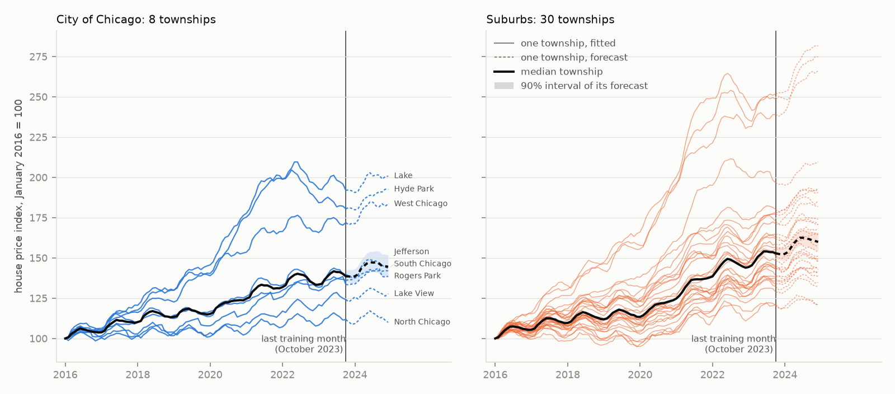
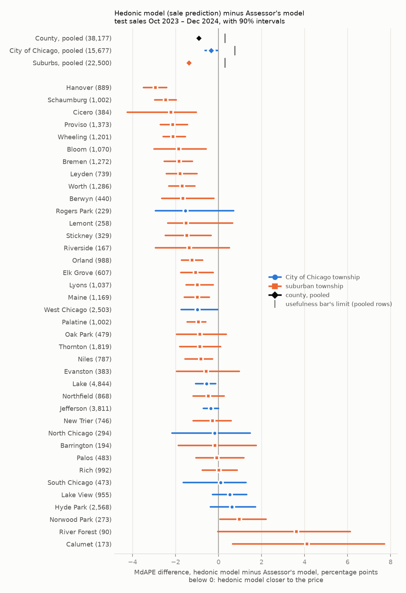
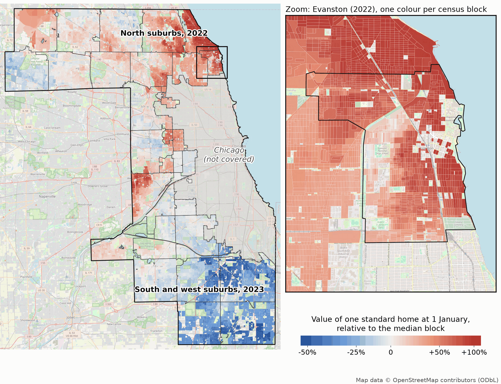
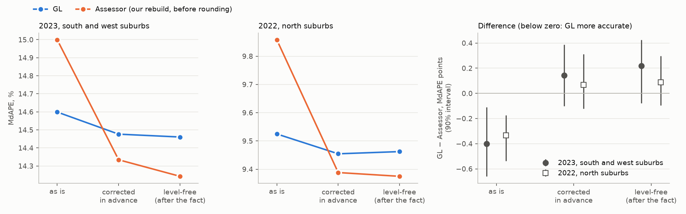
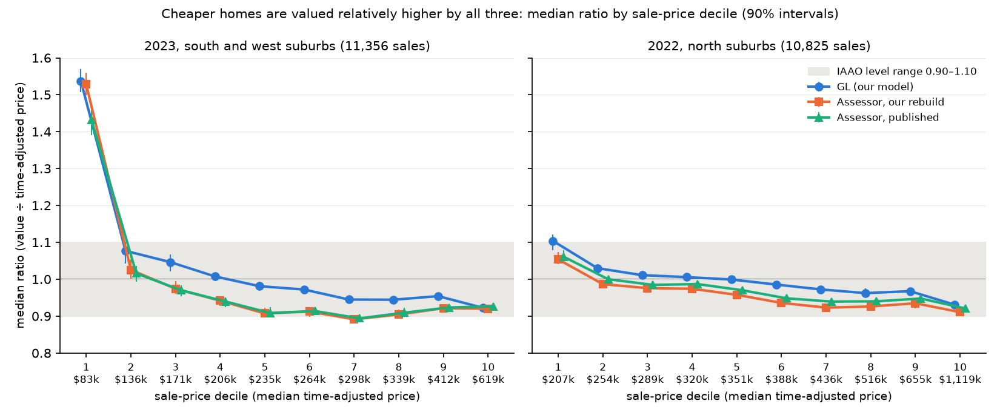
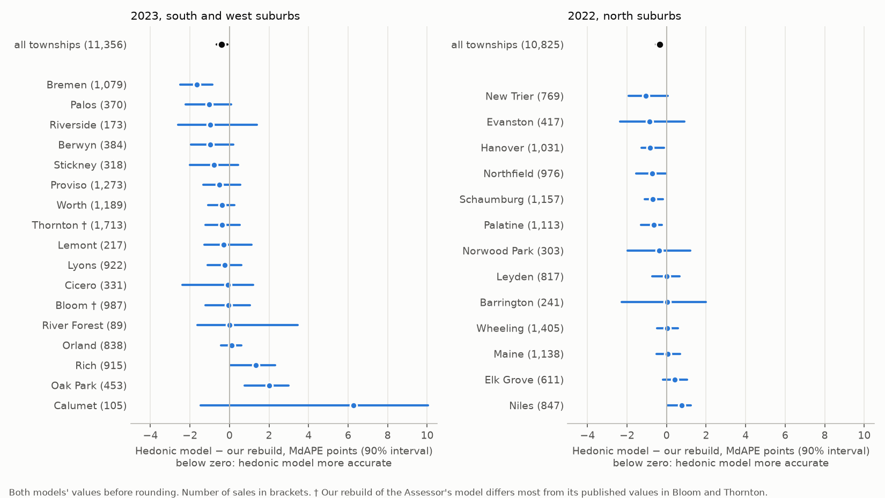

# An open house valuation model, validated on Cook County IL

This repository contains the code of the **GL model**, an open Bayesian house valuation model, and a comparison of it with the Cook County Assessor’s own valuation model in Cook County, Illinois.


<p align="center"><sub>Value of one standard house by census block across Cook County in October 2023, estimated by the GL sale-prediction model (<a href="#about-the-maps">about the maps</a>).</sub></p>

*Status: results are preliminary. Updated in October 2026 with the sale-prediction model.*

## Part 1: the GL model and its code

The GL model is the spatio-temporal house price model published by [Sijp and Francke (2026) in *Real Estate Economics*](https://onlinelibrary.wiley.com/doi/full/10.1111/1540-6229.70062). It is a Bayesian hedonic regression fitted in [Stan](https://mc-stan.org): the log sale price is explained by the home’s characteristics, such as size and age, a monthly price index, neighbourhood price levels, neighbourhood price paths over time, and fine-grained location effects for each 2020 census block. Blocks with few sales borrow information from neighbouring blocks. “GL” stands for graph Laplacian, the mathematical device that connects those neighbours. Every value splits exactly, on the log scale, into these parts (characteristics, price index, neighbourhood, block), so it can be explained term by term; the smoothing decides how much each part borrows from neighbouring areas, not whether it can be read.

The repository has two versions of the model. The **published model** above values homes at 1 January, as an assessor must. For **predicting sale prices** we extended it ([`stan/v2/gl_loop.stan`](stan/v2/gl_loop.stan)): separate models for houses and for two- to six-flat buildings, each home’s own sale history, a resale premium that fades with the time since the previous sale, age effects that differ by house type and size, and a price index that forecasts beyond its last training month. Each value still splits into named parts; the additions are described under [“The sale-prediction model”](#the-sale-prediction-model).

**What the model uses** (each item with its Assessor field and coding in the [full list](#the-regressors)):

- **The home**, as recorded by the Assessor: building area, land area, age, rooms, bedrooms, full and half bathrooms, fireplaces, basement type and finish, attic type and finish, central air conditioning, heating, exterior wall, roof, porch, garage size, attachment and walls, number of storeys (type of residence), cathedral ceiling, recent renovation, number of commercial units, the number of flats in a two- to six-flat building, and the Assessor’s property class (the 2025 data) or whether the garage is in the building area and the design plan (the 2022 and 2023 data).
- **Location:** the Assessor’s neighbourhood and the 2020 census block of the home’s map coordinates (in the sale-prediction model, flats are located by their own building instead of the block). No distances, amenities or census statistics.
- **Time:** the month of sale.
- **For sale prediction, also:** the dates of the home’s earlier sales (never their prices), and separate models for houses and for flats; for houses, age effects that differ by property class and size.

The model code can be used as a house valuation model more generally, fitted to other housing markets with sales, home characteristics and a spatial layout. A [related working paper (Sijp 2026, SSRN)](https://papers.ssrn.com/sol3/papers.cfm?abstract_id=7345003) compares the GL model with machine-learning models on Sydney house sales.

### Getting started

The repository runs two models on the same public data: the GL model, whose code is here, and, for comparison, the Cook County Assessor’s own valuation model, a LightGBM gradient-boosting model. The Assessor publishes that model’s code ([ccao-data/model-res-avm](https://github.com/ccao-data/model-res-avm)) but not its fitted runs, so the scripts here run it unchanged in Docker on the public inputs of each year (rebuilt from its code for 2022 and 2023, from the Assessor’s own container image for 2025) and do not redistribute it; the rebuild reproduces about three quarters of the Assessor’s published values exactly. [REPRODUCE.md](REPRODUCE.md) lists the prerequisites, the commands for each stage (including the Docker memory setting for the Assessor’s model), their runtimes and where every result is written. The scripts expect this repository to be in a subfolder named `public` inside a working folder:

```bash
mkdir work && cd work
git clone https://github.com/wsijp/gl-avm-cook.git public
public/reproduce.sh setup   # Python environment and CmdStan 2.39.0
public/reproduce.sh all     # download, prepare, rebuild the Assessor's model, fit, evaluate
public/reproduce.sh county final   # optional: the sale-prediction test (about a day)
```

On an Apple M5 laptop with 32 GB of memory, running three townships at a time, the GL fits take about 1 hour 40 minutes for the 30 townships of the 1 January tests and about 3½ hours for the published model on the whole county (38 townships). The sale-prediction model is a separate, optional step (`public/reproduce.sh final`): about 22 hours of fitting at three at a time, most of it one township (Lake, 11 hours).

### What is where

| File or folder | Purpose |
|---|---|
| [`stan/v2/gl_struct.stan`](stan/v2/gl_struct.stan) | The GL model as published (used for the 1 January tests) |
| [`stan/v2/gl_loop.stan`](stan/v2/gl_loop.stan) | The GL sale-prediction model (the published model with optional terms) |
| [`scripts/v2/`](scripts/v2/) | Python scripts for data preparation, fitting, valuation, evaluation and figures |
| [`scripts/v2/ay2022/`](scripts/v2/ay2022/) | Preparation and valuation scripts adapted for 2022 |
| [`assessor/`](assessor/) | Dockerfiles and the script that fetches and runs the Assessor’s model |
| [`figures/`](figures/) | Results figures |
| [`reproduce.sh`](reproduce.sh) | Runs the reproduction steps |
| [`REPRODUCE.md`](REPRODUCE.md) | Commands, software versions, runtimes and output locations |
| [`requirements.txt`](requirements.txt), [`inputs.sha256`](inputs.sha256) | Python dependencies and checksums for downloaded inputs |
| [`LICENSE`](LICENSE), [`CITATION.cff`](CITATION.cff) | Licence and citation information |

No data are included. The scripts download public inputs and create `data/` and `runs/` folders, which are ignored by git.

## Part 2: comparison with the Assessor’s model

We compare GL with the Assessor’s model in two settings: predicting later sale prices across Cook County, including Chicago, and valuing suburban homes at 1 January before that year’s sales are known.

**In predicting sale prices across the county, the GL sale-prediction model is more accurate than the Assessor’s model, in Chicago and in the suburbs.** On the Assessor’s own test of its 2025 model (38,177 sales from October 2023 to December 2024), the typical error (median absolute percentage error, MdAPE) of the GL predictions is 13.10% against 14.01% for the Assessor’s model: 0.91 percentage points lower (90% interval −1.05 to −0.76). It is lower by 0.35 points in Chicago (−0.62 to −0.06) and by 1.38 in the suburbs (−1.51 to −1.22). This meets, on every criterion, the bar for usefulness we fixed before the test. Most of the difference is the overall price level: the GL’s price index forecasts the market beyond its training sales, while the Assessor’s predictions fall further below the prices the later the sale. The published GL model, without these extensions, was less accurate than the Assessor’s on the same test (by 1.10 points).

**In valuing homes at 1 January, the GL values sit at the right overall level and the Assessor’s about 3–4% low, which makes the GL somewhat more accurate than our rebuild of the Assessor’s model, by 0.3–0.4 percentage points when both are compared before rounding.** Once each model’s level is corrected in advance, there is no clear difference in typical error.

### Results at a glance

- **MdAPE (median absolute percentage error):** the typical absolute gap between value and sale price, as a percentage of price; lower is better.
- **Median ratio:** the median of value ÷ sale price; 1.00 means the right overall level and 0.95 means about 5% low.
- **COD (coefficient of dispersion):** the average distance of ratios from their median, as a percentage of that median; lower means more uniform values.
- **PRD (price-related differential):** mean ratio ÷ (total value ÷ total sale price); above 1 indicates regressivity: cheaper homes receive higher values relative to their sale prices than dearer homes.

| Test and area | Model | Sales | MdAPE, % | Median ratio | COD | PRD |
|---|---|---:|---:|---:|---:|---:|
| **Sale prediction, whole county,** Oct 2023 – Dec 2024 | GL sale-prediction model | 38,177 | 13.10 | 0.982 | 21.5 | 1.077 |
| | Assessor’s 2025 model | | 14.01 | 0.950 | 22.6 | 1.087 |
| ↳ Chicago | GL sale-prediction model | 15,677 | 16.95 | 0.976 | 27.8 | 1.098 |
| | Assessor’s 2025 model | | 17.30 | 0.964 | 29.2 | 1.127 |
| ↳ Suburbs | GL sale-prediction model | 22,500 | 11.02 | 0.985 | 17.3 | 1.062 |
| | Assessor’s 2025 model | | 12.40 | 0.945 | 17.7 | 1.059 |
| **1 January assessment, south and west suburbs,** 2023 | GL published model | 11,356 | 14.60 | 0.988 | 22.8 | 1.074 |
| | Assessor, our rebuild | | 15.00 | 0.963 | 23.6 | 1.078 |
| **1 January assessment, north suburbs,** 2022 | GL published model | 10,825 | 9.52 | 0.993 | 12.9 | 1.032 |
| | Assessor, our rebuild | | 9.86 | 0.967 | 13.2 | 1.031 |

Compare models within each test; the tests use different sales, dates, models and evaluation rules. In the sale-prediction test, values are compared with the prices actually paid; in the 1 January tests, with sale prices adjusted to 1 January, and both models’ values before rounding. Chicago and the suburbs are parts of the county row, not further tests. The 1 January tests use the published GL model; the sale-prediction test uses the GL sale-prediction model. Every test covers single-family houses, town and row houses and two- to six-flat buildings (Assessor classes 202–212, 234, 278 and 295), not condominiums. A GL value is the posterior median of the model’s fitted price, without simulated sale-price error. The sale-prediction test’s sales had been used to evaluate earlier GL versions, and the 1 January sales to choose the GL’s structure (see “How much to trust it” and “Limitations”).

### Predicting sales across Cook County

The Assessor tests each year’s model by training it on the earlier 90% of its cleaned sales and predicting the latest 10%. We used its test for the 2025 model: training sales from January 2016 to 20 October 2023 and 38,177 test sales from 20 October 2023 to 27 December 2024 (sales of 20 October fall on either side, in the order of the Assessor’s file; a home can have sales in both), in all 38 townships, including Chicago’s eight. The GL was fitted to each township’s training sales and predicted every test sale; it sees no sale price after the training period. The Assessor’s predictions are those of its 2025 model, run unchanged on the same training sales.

**The GL sale-prediction model.** It extends the published model in four ways, each adopted during development only when it improved predictions of later sales in a test on earlier data, by a margin and rule fixed before the fits:

- **Separate models for houses and for flats.** Single-family houses and town or row houses form one model; whole two- to six-flat buildings another, with each flat building as its own location point, linked to its five nearest flat buildings in the same neighbourhood. Each is fitted separately in each township. In the 20 townships with too few flat sales for a model of their own (260 of the test sales), flats are valued by the published model fitted to houses and flats together, with the sale-history indicators below, and their values are held at October 2023.
- **Each home’s sale history.** Whether the home sold before and how long ago: for houses, earlier sales since 2016 in the Assessor’s data; for flats, earlier sales since 1999 in the county’s public Parcel Sales table. Only the dates of earlier sales are used, never their prices (though for flats, which earlier sales count depends on the Assessor’s price-based cleaning; see the details). A recent previous sale raises the expected price (a resale premium, for example after renovation); the premium fades as the time since that sale grows. For houses, a purchase followed by a quick resale (a “flip”) is marked, as such purchases are made at a discount; the premium and this discount also vary by neighbourhood, smoothed across neighbouring neighbourhoods.
- **Age effects by house type and size.** The effect of a house’s age may differ by the Assessor’s house class and with building size.
- **A forecasting price index.** Each township’s monthly price path is a damped trend with a seasonal pattern; beyond the last training month the model forecasts it, so each test sale is valued at its own month rather than at October 2023.



<p align="center"><sub>Each township’s house price path in the sale-prediction model (posterior median, January 2016 = 100), fitted to the training sales up to October 2023 and forecast after it (dashed). The left panel shows Chicago’s eight townships, the right the 30 suburban ones; the bold line is the pointwise median over the panel’s townships, and the band the 90% interval of that median over the posterior draws. The paths include the seasonal pattern; neighbourhood paths are not shown.</sub></p>

The two models do not use the same information. Both receive each home’s characteristics from the Assessor’s 2025 data. The Assessor’s model, fitted across the whole county, uses 95 predictors, among them the number of the home’s other sales in the four years before the sale, location codes, distances to amenities and other surrounding-area measures, census statistics, parcel shape and the sale date. The GL instead estimates location from each township’s own sales, by neighbourhood and census block (flat buildings for flats), and uses the dates of each home’s earlier sales and the month of the sale. In both, a test sale’s history can include an earlier sale in the test period, so the predictions are not all made from what was known in October 2023; the prices of those sales enter neither model.

**Results.** The GL is more accurate county-wide (13.10% against 14.01%, −0.91 points [−1.05, −0.76]), in Chicago (16.95% against 17.30%, −0.35 [−0.62, −0.06]) and in the suburbs (11.02% against 12.40%, −1.38 [−1.51, −1.22]). It is ahead in 31 of the 38 townships, with the 90% interval below zero in 19, and behind with the interval above zero in two, Calumet (+4.11 points on 173 sales) and Norwood Park (+0.96 on 273). Its values are less regressive (PRD 1.077 against 1.087) and slightly more uniform (COD 21.5 against 22.6). Before the test we fixed a bar for the GL to count as useful against the Assessor’s model: the upper end of the 90% interval below +0.3 points county-wide, below +0.75 in Chicago and below +0.3 in the suburbs, and a county PRD no higher than the Assessor’s. The sale-prediction model passes all four. (A fifth condition, being ahead at 1 January, is met by the published model; see below.)

**Most of the difference is price level.** The GL’s predictions sit closer to the prices on the median (median ratio 0.982 against 0.950). The Assessor’s predictions fall further below the prices the later the sale (median ratio 0.995 in October–December 2023, 0.934 in July–December 2024), while the GL’s forecast keeps up; the GL’s lead grows from 0.21 points in October–December 2023 to 1.39 in July–December 2024. After each model’s predictions are divided by its own median ratio on the test sales (an after-the-fact check neither model could make in advance), the county-wide difference is −0.06 points [−0.19, +0.09], not a clear difference. This does not mean the forecast alone explains the gain: several changes were adopted together, and their separate effects were not tested here.

**Where the GL is weaker.** On Chicago’s houses the point estimate favours the Assessor’s model, +0.24 points [−0.05, +0.54], not a clear difference, while the GL is well ahead on Chicago’s flats (−1.61). Chicago houses over 100 years old that had not sold since 1999 are overvalued by both models (median ratio 1.127 for the GL, 1.150 for the Assessor’s); the GL’s MdAPE for them, 25.0%, is higher than its first sale-history version’s, 23.2%. Homes resold two to four years after a previous sale, the window the Assessor’s four-year count covers, favour the Assessor’s model slightly (+0.53 [+0.01, +0.92]); homes resold after longer gaps favour the GL strongly. During development we also tried a second, boosted correction model fitted to the GL’s remaining errors; it was not adopted, so the model stays a single additive model whose values can be read term by term.



**How much to trust it.** Development used only sales before the test period, with earlier time splits. But this test set is not new: earlier versions of this project evaluated earlier GL models on the same sales (the published model, 1.10 points less accurate county-wide, and a first sale-history version, 0.59 points less accurate), and what they showed guided the choice of what to develop next. The sale-prediction model and its test were fixed before it was run, and development has stopped; still, it is a locked final comparison on a reused test set, not untouched confirmation, and the intervals do not account for that reuse. The test, its figures and the map at the top are reproduced by `public/reproduce.sh final` ([REPRODUCE.md](REPRODUCE.md)).

### Valuing homes at 1 January

An assessor must value every home on the roll at a fixed date, 1 January in Cook County, before the year’s sales are known. We value the same homes (single-family houses, two- to six-flat buildings and town houses) at the same date, from the same published training data, as the Assessor’s model, and check both against sales later in the year. Our benchmark is our rebuild of the Assessor’s model from its public code and data; the values the Assessor published are compared in the details below.

**As delivered, the GL values are somewhat more accurate than our rebuild of the Assessor’s model in both years.** Comparing both models’ values before rounding, their typical error is lower by 0.3–0.4 percentage points: 14.60% against 15.00% in 2023 (difference −0.40 points, 90% interval −0.66 to −0.11) and 9.52% against 9.86% in 2022 (−0.33, −0.54 to −0.18). The Assessor rounds its values down; with both models’ values rounded that way, the differences are −0.72 and −0.65 points (details below). What an assessor looks for:

- **Level:** the GL values are at the right overall level (median ratio 0.99); our rebuild of the Assessor’s values is about 3–4% low before rounding (0.96–0.97) and about 5% low after it (0.94–0.95).
- **Uniformity:** the GL values are slightly more uniform (COD lower by 0.8 points in 2023 and 0.2 in 2022).
- **Regressivity:** the two models are about equally regressive (PRD 1.07 for GL and 1.08 for the rebuild in 2023, 1.03 for both in 2022). In 2023 neither meets the guidance of the International Association of Assessing Officers (IAAO); in 2022 both are at its upper edge (details below).

**Once each model’s overall level is corrected in advance, there is no clear difference in typical error.** The correction divides each model’s values by its own median ratio on the previous October–December sales, using no prices after 1 January. GL minus rebuild MdAPE is then +0.20 points in 2023 (90% interval −0.05 to +0.42) and +0.09 in 2022 (−0.10 to +0.29). The GL’s advantage as delivered is therefore its level. It does not extend to two- to six-flat buildings, where the GL’s typical error is higher than the rebuild’s ([details](#1-january-tests-multi-family-homes-and-township-differences)).

The areas are the parts of the county the Assessor revalued in each year: 17 townships of the southern and western suburbs in 2023 (11,356 evaluation sales during 2023) and 13 of the northern suburbs in 2022 (10,825 during 2022). Chicago cannot be tested this way because the Assessor’s model inputs for its reassessment years (2021 and 2024) are not public; the sale-prediction test covers it.

## Details for expert readers

### Sale-prediction test: details

**Split.** The test uses the Assessor’s 2025 training file: sales from January 2016 to December 2024, less sales of parcels with more than one building record and sales the Assessor flagged as outliers (381,763 sales). Sorted by sale date, the first 343,586 train both models and the last 38,177 are the test, as in the Assessor’s own pipeline; our test sales are exactly the Assessor’s.

**GL.** The sale-prediction model ([“The sale-prediction model”](#the-sale-prediction-model)), fitted separately to each township’s house sales (38 fits) and, in the 18 townships where at least 300 flat buildings sold in training, in at least 24 different months, to its flat sales (18 fits); the other 20 townships’ flats come from the published model fitted to houses and flats together with sale-history indicators. Each fit uses four chains with 1,000 warm-up and 1,000 sampling iterations. A test sale is predicted at its own month, 1 to 14 months after the last training month; the 1,074 test sales of 20–31 October 2023 fall in that month and take its fitted value. The prediction is the median over 4,000 posterior draws. The home characteristics are the 26 among the 2025 model’s predictors, coded as in the 1 January tests but separately for houses and flats. The 56 new fits took 15 hours 53 minutes, three at a time (47 hours of fitting in all; Lake’s house fit alone 11.2 hours).

**Sale history.** For houses, every earlier sale of the home in the Assessor’s 2025 training file (since January 2016, whatever its flags); for flats, earlier sales in the county’s Parcel Sales table since 1999, filtered as the Assessor’s own sale query (which drops, among others, sales under $10,000 and sales the Assessor flagged as outliers). A test sale’s history can include an earlier test-period sale’s date, as the Assessor’s four-year count does; for flats, which earlier sales count also depends on those price-based flags. This is a retrospective design, not a forecast made only from what was known in October 2023.

**The Assessor’s model.** Its 2025 model, from the Assessor’s published container image (pinned by digest), trained on the training sales by its own pipeline. We compare its initial, unrounded predictions for the test sales.

**Intervals.** Differences are paired, GL minus the Assessor on the same sales. The 90% intervals use 2,000 redraws of homes within each township, keeping every sale of a drawn home, and hold the fitted models fixed. Township intervals are pointwise: across 38 townships, a few that exclude zero can arise by chance.

**Diagnostics.** Homes with an earlier sale since 2016: GL ahead by 2.07 points [−2.34, −1.81]; homes without: by 0.22 [−0.38, −0.07]. Houses: −0.85 [−0.99, −0.71]; flats: −1.17 [−1.66, −0.67]. Suburban flats show no clear difference (−0.18 [−1.32, +0.80]). The GL’s PRD is lower in Chicago (1.098 against 1.127) and very slightly higher in the suburbs (1.062 against 1.059).

**Convergence.** All 56 fits finished at the first attempt. Two townships are flagged by the rule fixed before the test: Lake View, whose flat model’s resale-premium curve did not mix (one chain stuck; R-hat, which compares the four chains, 1.28 against a threshold of 1.01; 30% of Lake View’s test predictions have R-hat above 1.01), and Northfield, whose flats come from the reused joint fit (R-hat 1.11). Without both, the difference is −0.96 county-wide, −0.39 in Chicago and −1.41 in the suburbs. Lake’s house fit mixed (R-hat 1.006), but 25% of its iterations reached the sampler’s maximum tree depth. The sampler reported 548 divergent transitions across most townships, a sign of difficult geometry.

**The published model on the same test.** Fitted unchanged (one model for houses and flats, the previous-sale count as a regressor, price paths held at October 2023), the published GL model’s MdAPE was 15.11% against the Assessor’s 14.01%: +1.10 points [+0.96, +1.23], +2.13 in Chicago and +0.36 in the suburbs ([by township](figures/county_by_township.png)). It is reproduced by `public/reproduce.sh county`, which the sale-prediction model’s step needs first.

### About the maps

The map at the top shows the sale-prediction model’s estimated value of the same standard house in each census block across Cook County, including Chicago, in October 2023, relative to the median block, on one colour scale. It comes from the house fits of the sale-prediction test. Some colour steps at township boundaries may reflect the separate township fits. Blank areas have no mapped estimate; thin light lines mark township boundaries and the dashed line the City of Chicago. The rectangle marks the enlargement of West Chicago township (right), which runs from the Near West Side to the city’s western edge.

For each census block, the map shows the log value of one standard house in the last training month $T$ (October 2023), $m = \alpha + x_\ast^\top \beta + \mu_T + \zeta_k + \psi_{kT} + u_s$ (posterior median; notation as in “Model details”), as $\exp(m - \tilde m) - 1$, with $\tilde m$ the median over the blocks shown (about $318,000). Every predictor is fixed: the standard house $x_\ast$ has the median of each numerical characteristic and the most common level of each categorical one over all 38 townships’ house training sales (a one-storey house, 62 years old, about 1,360 square feet of building on 6,000 of land, three bedrooms, one full bathroom, six rooms) and no earlier sale, so the resale terms are zero; it is coded as in each township, and its age effects follow its class and size. Colours are therefore comparable across townships. The colour scale ends at ±1 log point (−63% to +172%); 5.6% of blocks lie beyond it. Where a census block is split between neighbourhoods, the map shows the mean of its parts weighted by their numbers of homes. The block effects are rebuilt from the saved posterior draws; the rebuild reproduces every test sale’s fitted October 2023 value to within 2 × 10⁻⁶ on the log scale.

The second map shows the same quantity from the 1 January fits of the 30 suburban townships: the value at 1 January 2022 in the north and 1 January 2023 in the south and west, for a standard home with the median characteristics of those townships’ training sales (57 years old, about 1,460 square feet of building on 7,400 of land, three bedrooms), relative to the median block of the 30 townships together; its colour scale ends at ±0.75 log points (−53% to +112%). For that map we checked the steps at neighbourhood boundaries against sales within 400 m on either side, adjusted for characteristics and sale month by a simple regression (sales of the last three training years). Within townships its steps track the sales’ (correlation 0.79 over 750 boundaries, with the map’s step outside the sales’ 90% interval at 12% of them); across township lines, where separately fitted townships meet, less closely (0.64 over 104 boundaries, 28% outside). These results describe the second map; the check has not been repeated for the whole-county fits. The check’s script is not included in this release.



<p align="center"><sub>The 1 January fits: value of one standard home by census block, relative to the median block. Grey: Chicago, not covered by those tests. The rectangle marks the zoom on Evanston (right).</sub></p>

### 1 January tests: homes and sales covered

In 2023 we valued 336,532 homes across 17 southern and western townships, checking them against 11,356 sales from January to December 2023. In 2022 we valued 280,424 homes across 13 northern townships, checking them against 10,825 sales from January to December 2022.

Eligible homes have one building record, map coordinates and a building not shared with another parcel. They are in the Assessor’s classes 202–212, 234, 278 and 295: single-family houses, two- to six-flat buildings, and town and row houses. Condominiums are excluded. The Assessor treats some homes as identical units, such as the town houses of one development; both models give every home in such a group the same value.

Both models use the Assessor’s published training sales: 2014–2022 for the 2023 valuation and 2013–2021 for 2022. GL is fitted separately to each township’s sales; the Assessor’s model uses sales across the county, including Chicago. We apply the Assessor’s training filters for each year: both exclude parcels with multiple building records, while the 2023 filter also excludes sales flagged as outliers.

A later sale is used for evaluation only if:

- the Assessor did not flag it as an outlier and it covers one parcel;
- the home’s class and specified recorded characteristics are unchanged between the Assessor’s 1 January roll and its record of the home in the year of sale;
- no home-improvement exemption was active at the sale;
- it is the home’s first eligible sale that year.

The characteristics checked are building and land area, rooms, bedrooms, full and half bathrooms, garage size, basement, attic finish and year built. We apply no ratio-based trimming.

Neither model was fitted to the evaluation sales.

### Public sources

- **Model inputs:** the Assessor’s training sales, assessment rolls, groups of identical units and land rates, from its public bucket at `https://ccao-data-public-us-east-1.s3.amazonaws.com/models/inputs/res/<year>/<file>`. Inputs are downloaded for 2022, 2023 and 2025. In the 1 January tests, the 2025 training file supplies the later sales used for evaluation and the price index, and trains neither model. In the sale-prediction test it is the data: both models train on its earlier 90% and are tested on its latest 10%.
- **Parcel sales:** [Assessor – Parcel Sales](https://datacatalog.cookcountyil.gov/d/wvhk-k5uv), used to exclude sales covering multiple parcels in the 1 January tests and, from 1999, for the sale histories of flats in the sale-prediction model (dates only).
- **Published values:** [Assessor – Assessed Values](https://datacatalog.cookcountyil.gov/d/uzyt-m557), using the first-pass values mailed to owners. We multiply assessed values by 10 to put them on the market-value scale.
- **Census blocks:** US Census Bureau TIGER/Line [2020 Illinois census blocks](https://www2.census.gov/geo/tiger/TIGER2020/TABBLOCK20/tl_2020_17_tabblock20.zip).
- **Assessor model code:** [ccao-data/model-res-avm](https://github.com/ccao-data/model-res-avm), at tags `2023-assessment-year` and `2022-assessment-year` (1 January tests); for the sale-prediction test, the Assessor’s published container image of its 2025 model.
- **Map:** basemap tiles © [OpenStreetMap](https://www.openstreetmap.org/copyright) contributors.

### 1 January tests: time adjustment, rounding and uncertainty

Sale prices are adjusted back to 1 January using a separate monthly price index for each study area (not the GL model’s own index), fitted to sales from the assessment year and the preceding year. The index controls for neighbourhood, property class, building and land area, and age. Its 1 January level is the average of the December and January log-price effects. Homes are divided into five fixed groups; each group’s adjustments use an index fitted to the other four, so a home’s own sale never enters its adjustment.

The comparison uses both models’ values before rounding. For the Assessor, that is its model’s value for each home after the Assessor’s own adjustments and before rounding (`pred_pin_final_fmv` in the output of its assessment stage). The model’s raw output (`pred_pin_initial_fmv`) is the sum of its predictions for a parcel’s buildings; the adjustments cap some parcels with two buildings, average values across the parcels sharing a prorated building, and average them across a town-house complex. Among the evaluation sales only the complex averaging changes values (663 sales in 2023 and 1,375 in 2022, by a median 0.1–0.3%), and GL averages over the same groups, so these are the like-for-like values. With the raw output instead, GL minus rebuild MdAPE is −0.43 points in 2023 and −0.40 in 2022.

The Assessor then rounds its values down (to the $10,000 below from $100,000, to the $5,000 below from $10,000, to the $500 below from $1,000), which lowers them by a median 1.9% on the 2023 evaluation sales and 1.2% on the 2022 ones; the values it publishes are rounded. With both models’ values rounded that way, MdAPE is 14.95% for GL against 15.67% for the rebuild in 2023 (−0.72 points [−0.99, −0.45]; median ratio 0.969 against 0.944) and 9.75% against 10.39% in 2022 (−0.65 [−0.86, −0.47]; 0.980 against 0.954). Rounding down lowers both models’ level, and the GL, starting from the right level, loses less accuracy by it.

Differences are paired—GL minus the other model on the same sales—and computed from unrounded statistics, so they can differ slightly from differences of the table’s entries. The 90% intervals use 2,000 bootstrap redraws, keeping homes in an identical-unit group together and resampling separately within townships. They reflect uncertainty about which sales were observed, holding the fitted models, price index and correction factors fixed.

The level correction of Part 2 comes in two versions. The one quoted there uses the October–December sale prices as they are, so it uses no prices after 1 January (we have not checked whether every sale record was already available then). The figure below uses those prices time-adjusted to 1 January, with the index above, which is estimated partly from later sales; it gives GL minus rebuild +0.14 points [−0.10, +0.39] in 2023 and +0.07 [−0.12, +0.31] in 2022. “Level-free” MdAPE instead divides each model’s values by its own median ratio on the evaluation sales themselves; it is an after-the-fact diagnostic.



<p align="center"><sub>This figure still compares GL with the rebuild’s rounded values (the comparison used before 22 October 2026); it has not yet been redrawn with unrounded values.</sub></p>

### Model details

For sale *i* of a home with characteristics $x_i$, in month $t_i$, Assessor neighbourhood $k_i$ and census-block unit $s_i$, the model is

$$\log p_i = \alpha + x_i^\top \beta + \mu_{t_i} + \zeta_{k_i} + \psi_{k_i t_i} + u_{s_i} + \varepsilon_i, \qquad \varepsilon_i \sim t_\nu(0, \sigma_\varepsilon),$$

with $\mu$ the township’s monthly price index over the training months (108 in the 1 January tests, 94 in the sale-prediction test), $\zeta$ the neighbourhood levels, $\psi$ the neighbourhood price paths and $u$ the block effects. In the 1 January tests, the regressors $x_i$ are the Assessor’s 27 home characteristics plus its proration rate (the share of a building’s value assigned to the parcel), which is 1 for every home valued there; in the published model’s sale-prediction fits, they are the 2025 model’s 26 home characteristics plus the previous-sale count. Areas enter as logs, year built as age, numerical characteristics standardised and categorical ones as indicators; this coding is learned from each township’s training sales only (see [`prep_v2.py`](scripts/v2/prep_v2.py)), and the regressors are centred. Every regressor is listed below.

#### The regressors

The Assessor’s field names are those of its model inputs; the meanings follow the documentation of its model. “1 Jan” marks a characteristic of the 2022 and 2023 data only (the 1 January tests), “2025” one of the 2025 data only (the published model’s sale-prediction fits); every sale-prediction fit uses the 2025 data.

| Assessor field | Meaning | Coding | Published model | Sale prediction: houses | Sale prediction: flats |
|---|---|---|:---:|:---:|:---:|
| `char_bldg_sf` | Building area, square feet measured from the exterior | log, standardised; flats: per flat | yes | yes | yes |
| `char_land_sf` | Land area of the parcel, square feet | log, standardised | yes | yes | yes |
| `char_yrblt` | Year built | as age: sale year − year built for sales; valuation year − year built for 1 January values; standardised | yes | yes | yes |
| `char_rooms` | Rooms, excluding bathrooms | standardised; flats: per flat | yes | yes | yes |
| `char_beds` | Bedrooms | standardised; flats: per flat | yes | yes | yes |
| `char_fbath` | Full bathrooms | standardised; flats: per flat | yes | yes | yes |
| `char_hbath` | Half bathrooms | standardised; flats: per flat | yes | yes | yes |
| `char_frpl` | Fireplaces | standardised | yes | yes | yes |
| `char_ncu` | Commercial units | standardised | yes | no (0 for every house) | yes |
| `char_recent_renovation` | Renovated within the last three years | 1 or 0 (missing as 0) | yes | yes | yes |
| `char_apts` | Number of flats in a two- to six-flat building (two to six, unknown, none) | published: indicators; flats: log(flats ÷ 2) and an indicator for an unknown number, which takes the township’s median known number | yes | no | yes |
| `char_class` | Assessor property class: for houses, its classes by storeys, size and age, split level, and row or town house; for flats, two- to six-flat building (211) or mixed commercial and residential building (212) | indicators | 2025 | yes | yes |
| `char_type_resd` | Type of residence: one, one and a half, two, three or more storeys, split level | indicators | yes | yes | yes |
| `char_bsmt` | Basement: full, partial, slab, crawl space | indicators | yes | yes | yes |
| `char_bsmt_fin` | Basement finish: recreation room, apartment, unfinished | indicators | yes | yes | yes |
| `char_attic_type` | Attic: full, partial, none | indicators | yes | yes | yes |
| `char_attic_fnsh` | Attic finish: living area, partial, none | indicators | yes | yes | yes |
| `char_air` | Central air conditioning | indicators | yes | yes | yes |
| `char_heat` | Heating: warm-air furnace, hot water or steam, electric, none | indicators | yes | yes | yes |
| `char_ext_wall` | Exterior walls: frame, masonry, both, stucco | indicators | yes | yes | yes |
| `char_roof_cnst` | Roof material | indicators | yes | yes | yes |
| `char_porch` | Porch: none, frame enclosed, masonry enclosed | indicators | yes | yes | yes |
| `char_gar1_size` | Garage size in cars, including none | indicators | yes | yes | yes |
| `char_gar1_att` | Garage attached | indicators | yes | yes | yes |
| `char_gar1_cnst` | Garage walls: frame, masonry, both, stucco | indicators | yes | yes | yes |
| `char_tp_dsgn` | Cathedral ceiling (a field the Assessor marks as deprecated) | indicators | yes | yes | yes |
| `char_gar1_area` | Garage included in the building area | indicators | 1 Jan | no | no |
| `char_tp_plan` | Design plan (architect or stock plan) | indicators | 1 Jan | no | no |
| `meta_tieback_proration_rate` | Proration rate: the share of a building’s value assigned to the parcel (1 for every home valued at 1 January) | standardised | 1 Jan | no | no |
| `meta_sale_count_past_n_years` | The Assessor’s count of the home’s sales in the four years before the sale | standardised | 2025 | no | no |
| Sold before | An earlier sale of the home since January 2016 (any sale in the Assessor’s 2025 training file) | 1 or 0, standardised | no | yes | no |
| Time since the previous sale | The latest earlier sale less than 1, 1–2 or 2–4 years before (reference: 4 years or more, or none) | three indicators, standardised | no | yes | no |
| Flip purchase | A training sale followed by the home’s next training sale within 12 or 12–24 months; 0 for every sale to be predicted | two indicators, standardised | no | yes | no |
| Age by class | Age times each property-class indicator the township keeps | age centred on the township’s mean; product standardised | no | yes | no |
| Age by size | Age times log building area | both centred on the township’s means; product standardised | no | yes | no |

Coding, learned from the training sales of each township (and, in the sale-prediction model, of each segment, houses or flats) only:

- **Numerical characteristics:** a missing value or a non-positive area takes the training median; then logs where shown, and standardisation with the training mean and standard deviation. For flats, bedrooms, rooms, full and half bathrooms and building area are divided by the number of flats.
- **Categorical characteristics:** one indicator per level, against the most common training level; levels with under 1% of training sales are merged into “other”, while a missing value keeps a level of its own however rare. A level not seen in training is coded as “other”, or as the most common level if there is no “other”.
- **Dropped columns:** a column without variation in a township’s training sales, or exactly collinear with earlier columns, is dropped, and listed in that township’s `coding.json`. The number of commercial units, for example, is dropped in every house fit, and an indicator for a missing value is often dropped because the same homes lack another characteristic too.
- All regressors are centred and enter through a QR decomposition with the same $N(0, 1)$ prior on their coefficients.

The model’s other parts are not regressors: the intercept; the township’s monthly price index (a random walk; in the sale-prediction model a damped trend with a calendar-month pattern, forecast beyond the last training month); the neighbourhood levels and neighbourhood price paths, by Assessor neighbourhood; the location effects of census blocks (in the sale-prediction model, flat buildings for flats); in the sale-prediction model, the neighbourhood deviations of the houses’ resale premium and flip discount, and the flats’ resale premium curve from their earlier sales since 1999; and the Student-t errors. They are described below and under [“The sale-prediction model”](#the-sale-prediction-model). In the 20 townships whose flats are valued by the published model fitted to houses and flats together, that fit uses the published model’s 2025 regressors with the sold-before and time-since indicators, one set for houses and one for flats, in place of the previous-sale count.

Each effect has a whitened graph-Laplacian prior, as in Sijp and Francke (2026). For a graph with Laplacian $L = U \Lambda U^\top$, let the whitener $A = U_+ \Lambda_+^{-1/2}$ over the eigenvectors with non-zero eigenvalue; an effect is $\sigma A z$ with $z \sim N(0, I)$, so its prior covariance is $\sigma^2 L^+$. $A_T$, $A_K$ and $A_u$ are the whiteners of the month, neighbourhood and block graphs. Dropping the null space makes each effect sum to zero over its graph, leaving the intercept $\alpha$ to carry the overall price level.

- $\mu = \sigma_\mu A_T z_\mu$ over the path graph of months: a first-order random walk.
- $\zeta = \sigma_\zeta A_K z_\zeta$ over the neighbourhood graph.
- $\psi = \sigma_\psi A_K Z_\psi A_T^\top$ with independent standard-normal entries in $Z_\psi$, so $\mathrm{vec}(\psi)$ has prior covariance $\sigma_\psi^2 (L_T^+ \otimes L_K^+)$: each neighbourhood’s price path is a random walk, smoothed across neighbouring neighbourhoods.
- $u = \sigma_u A_u z_u$ with one graph per neighbourhood, so block effects sum to zero within each neighbourhood. Each neighbourhood’s whitener is scaled to unit geometric-mean marginal variance. Blocks without training sales are estimated jointly with the rest, through their neighbours in this prior.

Blocks crossing Assessor neighbourhood boundaries are split. Blocks within a neighbourhood are connected when they share a boundary line, and neighbourhoods are connected when their blocks share one. Disconnected parts are joined by a minimum spanning tree using distances between block outlines.

Priors (normal distributions given by mean and standard deviation): $\alpha \sim N(\bar y, 10)$ with $\bar y$ the mean training log price; $\beta \sim N(0, 1)$, sampled through a QR decomposition of the regressors; half-normal scales $\sigma_\mu, \sigma_\psi \sim N^+(0, 0.1)$, $\sigma_\zeta, \sigma_u \sim N^+(0, 0.5)$ and, for the Student-t scale, $\sigma_\varepsilon \sim N^+(0, 0.25)$ with $\sigma_\varepsilon \ge 0.01$; degrees of freedom $\nu \sim \text{Gamma}(2, 0.1)$ (shape, rate) on $[2, 40]$.

The model is fitted separately to each township using four chains with 1,000 warm-up and 1,000 sampling iterations each, all started at the posterior mode found by optimisation (seed 1; CmdStan 2.39 through cmdstanpy 1.3.0; [REPRODUCE.md](REPRODUCE.md) lists the settings and versions). For 1 January valuation, the township and neighbourhood price paths ($\mu$ and $\psi$) are held at their December values; in the published model’s sale-prediction fits, at their October 2023 values. Each home’s value is the median of its fitted prices across 4,000 posterior draws, without simulated sale-price error. For groups the Assessor treats as identical units, member prices are averaged within each draw before taking the median.

A simpler model with one block graph per township and no neighbourhood effects was also fitted. A rule fixed before fitting retained that simpler model unless the upper end of the 90% interval for its MdAPE disadvantage, on both years’ evaluation sales together, exceeded +0.5 percentage points. Its disadvantage was +0.81 points [+0.69, +0.93], so the model with neighbourhood effects was retained.

### The sale-prediction model

The sale-prediction model ([`stan/v2/gl_loop.stan`](stan/v2/gl_loop.stan), fitted by [`loop_fit.py`](scripts/v2/loop_fit.py)) keeps every term, prior and whitened graph of the published model and adds the following. Houses (Assessor classes 202–210, 234, 278 and 295) and flats (211 and 212) are fitted separately, and each coding of the characteristics is learned from that segment’s training sales.

- **Price index.** $\mu_t = \tau_t + s_{c(t)}$, centred over the training months. The trend’s monthly increments $d_t = \tau_t - \tau_{t-1}$ follow $d_t = \delta + \phi (d_{t-1} - \delta) + \sigma_\mu e_t$, $e_t \sim N(0, 1)$: a damped trend (with $\phi = \delta = 0$ it is the published model’s random walk). $s$ is a calendar-month effect, $s = \sigma_s A_c z_s$ with $A_c$ the whitener of the 12-month cycle graph (December joined to January), so it sums to zero over the year and is smooth across neighbouring months; $c(t)$ is the calendar month of $t$. Priors: $\delta \sim N(0, 0.01)$, $(\phi + 1)/2 \sim \text{Beta}(2, 2)$, $\sigma_s \sim N^+(0, 0.05)$. Beyond the last training month $T$, the trend continues its increments with new draws of $e$ and the neighbourhood paths $\psi$ continue their random walk; a sale in month $T + h$ is valued with $\mu_{T+h}$ and $\psi_{k, T+h}$, draw by draw, inside Stan.
- **Sale history (houses).** Among the regressors: an indicator that the home sold before (since January 2016) and indicators that the latest earlier sale was less than 1, 1–2 or 2–4 years before; two flip-purchase indicators, marking a training sale followed by the home’s next sale within 12 or 12–24 months (0 for every sale to be predicted).
- **Neighbourhood-varying resale terms (houses).** $\sum_j \ell_{ij}\, \gamma_{k_i j}$ with $\gamma_{\cdot j} = \sigma_{\gamma j} A_K z_{\gamma j}$ (whitened neighbourhood graph prior, summing to zero over neighbourhoods, around the township coefficients; $\sigma_{\gamma j} \sim N^+(0, 0.1)$). The loadings are $\ell_{i1} = w(g_i)$ for a home sold before, with $g_i$ the years since the latest earlier sale and $w = 1$ up to 2 years, falling along a cosine to 0 at 4 years, and $\ell_{i2}$ = 1 for a flip purchase.
- **Age interactions (houses).** Age (centred) times each house-class indicator the township’s coding keeps, and age times log building area (centred), standardised among the regressors with the same $N(0, 1)$ prior.
- **Flats.** The location units are the flat buildings, connected to their five nearest flat buildings within the neighbourhood, instead of census blocks. Sale history since 1999 (the county’s Parcel Sales table) enters as a premium that rises over the first months and then fades: $a\,(1 - e^{-g/0.25})\, e^{-g/\tau}$ for a building sold before, with $g$ in years, $a \sim N(0, 1)$ and $\log \tau \sim N(\log 6.77, 0.5)$; the prior median of 6.77 years was estimated on pooled training sales before the test was set up.

The regressors’ coefficients are sampled through a QR decomposition as before. A column without variation in a township’s training sales, or collinear with earlier ones, is dropped and listed in the preparation’s `coding.json`. Each fit starts from the posterior mode found by optimisation, perturbed independently for each chain.

### 1 January tests: regressivity and appraisal guidance

The GL and rebuilt Assessor values are similarly regressive. Price-related bias (PRB) is roughly the proportional change in the ratio when a home’s value doubles (the slope of the relative ratio on the base-2 logarithm of a proxy averaging value and price). It is −0.124 for GL and −0.145 for the rebuild in 2023, and −0.034 and −0.033 in 2022. Negative values indicate higher ratios for cheaper homes.

The IAAO’s *Standard on Ratio Studies* (2013) suggests a COD of 5.0–15.0 for single-family homes, 5.0–10.0 in newer or fairly similar areas, and 5.0–20.0 for two- to four-unit buildings; a PRD of 0.98–1.03; and a PRB between −0.05 and +0.05. On single-family sales alone, both models fall outside all three ranges in the 2023 area. In 2022, both fall within the COD and PRB ranges and just above the PRD range (single-family PRD 1.034 for both). Unlike many assessment ratio studies, ours does not trim outlying ratios.



<p align="center"><sub>This figure still compares GL with the rebuild’s rounded values (the comparison used before 22 October 2026); it has not yet been redrawn with unrounded values.</sub></p>

Grouping by sale price can exaggerate apparent regressivity because a home that happens to sell cheaply has both a low price and a high ratio. PRB is less affected because of its proxy. The shaded 0.90–1.10 band is IAAO guidance for overall appraisal level, shown for reference, rather than a standard for price groups.

### 1 January tests: multi-family homes and township differences

For two- to six-flat buildings, GL’s typical error is higher than the rebuild’s: by +1.83 percentage points [+0.57, +2.69] in 2023 and +1.59 [+0.30, +3.00] in 2022. Correcting the overall level does not remove this gap. GL sees relatively few such sales within most townships, while the Assessor’s model learns from the whole county, including Chicago. A variant coding the number of flats numerically instead of categorically did not close the gap; its scripts are not included.

Some townships favour the Assessor’s model, including Oak Park, where GL’s MdAPE is +2.02 points higher [+0.76, +2.98] in 2023.



<p align="center"><sub>This figure still compares GL with the rebuild’s rounded values (the comparison used before 22 October 2026); it has not yet been redrawn with unrounded values.</sub></p>

### 1 January tests: published values and the rebuild

The values the Assessor published, on the same evaluation sales as the headline table. Published values are rounded down, so in this table all values, including GL’s, are rounded the Assessor’s way:

| Area and year | Values | MdAPE, % | Median ratio | COD | PRD |
|---|---|---:|---:|---:|---:|
| South and west, 2023 | GL | 14.95 | 0.969 | 22.8 | 1.069 |
| | Assessor, our rebuild | 15.67 | 0.944 | 23.6 | 1.072 |
| | Assessor, published | 15.73 | 0.942 | 23.5 | 1.061 |
| North, 2022 | GL | 9.75 | 0.980 | 13.0 | 1.029 |
| | Assessor, our rebuild | 10.39 | 0.954 | 13.3 | 1.028 |
| | Assessor, published | 9.55 | 0.966 | 12.7 | 1.028 |

In 2022, the Assessor’s published values are more accurate than our rebuild for homes sold early in the year. For January–April sales, MdAPE is 7.9% for published values against 10.3% for the rebuild; for September–December sales, both are 10.5%. This suggests that the published values for those homes reflect information from those sales, which neither model had at 1 January. For comparing methods, our rebuild is therefore the fairer benchmark; the published values are shown for completeness.

Our rebuild runs the Assessor’s tagged training and valuation code unchanged, using public inputs. It is not the production run. It reproduces published values exactly for 72% of 362,957 homes with both values in the 2023 area and 76% of 294,805 in 2022, including homes excluded from our valuation sample.

Bloom and Thornton differ more noticeably in 2023. In Bloom, rebuilt values are a median 9% above published values and only 27% match within $1 on the assessed-value scale, against 86% in the whole 2023 area; in Thornton, 68% match. Excluding both townships leaves the GL’s MdAPE advantage over the rebuild slightly smaller: −0.31 points [−0.60, −0.05].

Published 2023 values are less regressive than both models overall. Excluding Bloom and Thornton, published and rebuilt values have the same PRD, 1.054, compared with GL’s 1.061.

### 1 January tests: earlier sales and the sale-history check

Both models value homes that also sold during training lower relative to their later prices than homes without an earlier sale. The median-ratio gap is about 0.12 in 2023 and 0.07 in 2022.

To check how much GL depends on a home’s own earlier sales, we selected 704 homes at random from the 2023 evaluation sales with earlier sales, removed their earlier sales and refitted all 17 townships. Their values rose by a median 0.65% [0.59%, 0.73%], within the ±1% band fixed in advance for this median. The median size of the change, 0.93%, is larger than the 0.11% median difference between two random seeds for the same homes. The check required 17 further fits; its scripts are not included in this release.

### Limitations

Both tests are retrospective. The 1 January tests compare two years in two different areas; year and area change together, so their effects cannot be separated. Condominiums are not covered, and Chicago only in the sale-prediction test. The 1 January evaluation sales were also used to choose between GL and its simpler version (see “Model details”); the sale-prediction test sales had been used to evaluate earlier versions of the GL (Part 2). The 1 January tests use the published model, without sale history, which already does well there and is simpler; the sale-prediction extensions have not been tested at 1 January. An assessment model that uses sale history would first need a ratio study by sale-history group, so that recently sold homes are not valued differently from unsold ones.

The 1 January results depend on adjusting sale prices to the valuation date. Without adjustment, GL’s MdAPE advantage over the rebuild grows to −1.04 points in 2023 and −1.31 in 2022. Prices rose during both years; our interpretation is that unadjusted prices favour the model with the higher overall level.

In the 1 January tests, all neighbourhood effects, block effects and home values meet R-hat ≤ 1.01 across the 30 townships (the four chains agree). Some scale parameters reach 1.015. The sampler reported divergent transitions, a sign of difficult geometry, in five township fits: 116 of 4,000 sampling iterations in Norwood Park in 2022, and fewer than 15 in each of the other four. These fits were recorded rather than refitted. A second random seed gave a similar GL minus rebuild MdAPE difference on both years’ sales together, −0.98 against −0.97 points (against the rebuild’s rounded values; not repeated before rounding).

Exact reproduction is not guaranteed. Open-data queries are live and their contents can change; software and compiler differences may also affect results. [REPRODUCE.md](REPRODUCE.md) records downloads, checksums and reproduction limits. The sale-prediction tests are separate, optional steps (`public/reproduce.sh county` for the published model, about 3½ hours, then `public/reproduce.sh final` for the sale-prediction model, about a day); the sale-history check, the map boundary check and the number-of-flats variant are outside the released workflow.

## Licences and terms

- **Repository code:** MIT licence ([LICENSE](LICENSE)).
- **Assessor model code:** AGPL-3.0. It is not included or redistributed here. [`assessor/rebuild.sh`](assessor/rebuild.sh) fetches it from [ccao-data/model-res-avm](https://github.com/ccao-data/model-res-avm) at the year’s tag and runs it unchanged, using our Dockerfiles following each tag’s build recipe.
- **Data:** none are included. Check each source’s terms before reuse. The Assessor offers its model inputs for public download; we found no stated licence for them. We also found no stated licence for the parcel-sales and assessed-values datasets; the portal links to Cook County’s general [terms of use](https://www.cookcountyil.gov/terms-use). Census blocks are published by the US Census Bureau and, as US federal government works, are not subject to copyright in the United States.
- **Map:** the basemap of the location map is © OpenStreetMap contributors, available under the [Open Database Licence](https://www.openstreetmap.org/copyright).

## References

- Sijp, W. P. and Francke, M. K. (2026). Graph-Laplacian modeling of spatiotemporal effects for house price estimation. *Real Estate Economics* (volume and pages not yet assigned). <https://doi.org/10.1111/1540-6229.70062>
- Sijp, W. (2026). Scale and Local Information in Housing Markets: A Graph-Laplacian AVM Benchmarked Against Machine Learning. SSRN working paper. <https://papers.ssrn.com/sol3/papers.cfm?abstract_id=7345003>
- International Association of Assessing Officers (2013). *Standard on Ratio Studies*. Kansas City, MO: IAAO.

## How to cite

For the model, cite Sijp and Francke (2026). For this code and its results, cite this repository. [`CITATION.cff`](CITATION.cff) holds both: GitHub’s “Cite this repository” button shows the model paper as the preferred citation, and the file also describes the repository itself.
